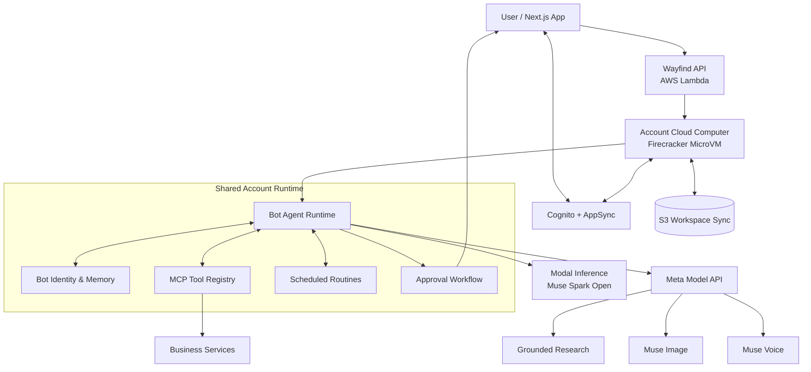

# Wayfind Cloud

> Always-on AI teammates for small businesses — powered by Meta open-weight models + serverless Firecracker microVMs.

**Hackathon Highlights**
- Always-on AI teammates that work across **100+ business apps**
- Each account gets an isolated Firecracker microVM that **pauses when idle and resumes in seconds**
- Primary intelligence: **Muse Spark Open** (self-hosted on Modal) + Muse Image, Muse Voice, and grounded search
- Real business workflows: bookkeeping, reconciliation, invoicing, approvals, and routines
- Built for affordability — continuous AI without enterprise cost

## Overview

Small businesses already use AI to cut the cost of professional services. Work that once took an accountant, auditor, or consultant 10 hours can often be reduced to 2–3 hours when AI organizes records, prepares documents, and handles routine tasks. Human professionals are still essential, but businesses can spend less on repetitive billable hours.

Wayfind delivers always-on AI teammates for everyday business workflows. Connected to 100+ business apps, they operate directly within the tools teams already use. We combined Meta's cost-efficient open-weight models with serverless Firecracker microVMs on AWS. Each account gets a lightweight, isolated cloud computer that pauses when idle and resumes in seconds, making continuous, always-available AI practical and affordable for small teams.

## Quick links

| Resource | Link |
|---|---|
| Live | https://wayfind.click |
| Video Demo (3 mins) | https://youtu.be/TM7GRNuOMcY |
| Documentation | https://wayfind.click/docs |
| Presentation | [Pitch deck](./docs/presentation.html) |
| X | https://x.com/WayfindCloud |

## Background

AI help for business work arrived in three generations. Each added power — and each still demands something a small team can't spare:

| Generation | What it added | What it still demands |
|---|---|---|
| Chat (2022 onwards) | Answers on demand — ask anything, get a draft | Your time: copy-paste across apps, no memory of your tools |
| Self-hosted automation (2024 onwards) | Full automation with open-source tools on a cloud server | Your ops: separate VM & AI bills, $50–70/month, setup and upkeep |
| Always-on agents (2026 onwards) | Agents that work 24/7, from Grok Bot to OpenAI Dots and Claude Duet | Your independence: bundled into suites, not sold standalone, enterprise IT expected |

## System overview

Wayfind gives each account a team of named Bots and one shared cloud computer for them to work on — an isolated Firecracker MicroVM that suspends when idle and resumes in seconds.

- **The team:** Bots with their own job, memory, and face — message them like colleagues.
- **The computer:** one per account, shared by all Bots, with files, browser, and tools in one workspace.
- **The trust:** connect apps once for the whole team, schedule routines that run on their own, and approve anything irreversible before it happens.

## User flow

1. **Start free.** Sign in, no credit card.
2. **Meet Wayfind.** Every account starts with a Wayfind Bot, a chief of staff that already knows its way around.
3. **Create Bots per job.** “Aria — bookkeeping” beats “Assistant”: one Bot per job, with its own memory, color, and shape.
4. **Connect your tools.** Import a connector once — Zoho CRM, Stripe, Outlook — and every Bot can use it immediately.
5. **Hand off real work.** “Reconcile last week's invoices.” Bots work in the background on your cloud computer; close the laptop, come back to results.
6. **Approve what matters.** Bots stop for your OK before sending, paying, publishing, or changing important records.
7. **Automate.** Make a reliable job recurring and it becomes a routine — run history, pause/resume included.

Full walkthrough: https://wayfind.click/docs/quickstart

---

## System architecture



### Task execution lifecycle

A typical task moves through the following stages:

1. **Receive:** The user sends a task to a specific Bot.
2. **Load context:** Wayfind loads the Bot's identity, memory, and account context.
3. **Resume:** The account's cloud computer is made available if suspended.
4. **Reason:** The agent uses Muse Spark Open to interpret the task and determine the next steps.
5. **Execute:** The agent accesses workspace files and connected services through its available tools.
6. **Specialize:** Grounded research, image generation, or voice transcription uses the corresponding Meta model capability.
7. **Review:** The Bot prepares the result and requests approval for configured sensitive actions.
8. **Persist:** Workspace changes are synchronized so future work can continue from the existing environment.

---

## Business tools, connected once

Bots work where business work already happens. Connect an app once at the account level and every Bot can use it — no copy-paste between tabs.

Zoho is our deepest bench: Books, CRM, Mail, Desk, Billing, Invoice, Expense, Payroll, People, Calendar, Cliq, Bookings, Sign, Meeting, Forms, Survey, Social, and WorkDrive — thousands of Bot-ready actions from reconciling banks to drafting emails.

| Area | Example apps |
|---|---|
| Sales & CRM | Zoho CRM, HubSpot, Pipedrive, Apollo |
| Finance | Zoho Books, Zoho Billing, Stripe, FreshBooks |
| Email & comms | Zoho Mail, Outlook, Teams, Twilio |
| Support | Zoho Desk, Zendesk, Freshdesk |
| Marketing | Zoho Social, Mailchimp, Klaviyo, Brevo |
| Projects | Asana, ClickUp, Monday, Jira |
| Scheduling | Zoho Bookings, Calendly, Cal.com |
| Files & ops | Zoho WorkDrive, Notion, Zoho Sign |

Full list: https://wayfind.click/connectors. Sensitive actions can be gated by approval workflows.

---

## AWS infrastructure

AWS provides the execution, storage, authentication, and application infrastructure.

| Service | Responsibility |
|---|---|
| **Lambda MicroVMs / Firecracker** | Isolated account-level cloud computers |
| **Amplify** | Next.js hosting, backend functions, and application infrastructure |
| **S3** | Persistent workspace synchronization and distribution of MCP registry and skills |
| **AppSync** | Application data and real-time updates |
| **Cognito** | Authentication and account identity |

The important distinction is that Wayfind does not provision one permanently running machine for every Bot. It shares one account-level computer across the AI team and suspends execution when idle.

---

## Implementation details

The main application is built with Next.js and TypeScript. The cloud computer hosts the agent runtime and its available tools.

**What the computer is:** `packages/computer/` is a Node.js agent server (agent loop, tools, MCP clients, skills, routines, approvals, usage metering) that runs inside an AWS Lambda MicroVM. Each account gets one isolated VM; Bots share it.

**Local vs cloud:**

| | Local | Cloud |
|---|---|---|
| Agent server | `npx tsx src/server.ts` on `:8080` for development | Same server compiled to `dist/`, baked into the MicroVM image |
| Workspace | `packages/computer/workspace/` on disk | Synced to S3 per account, restored on resume |
| Keys | `.env` / keystore on your machine | Zero keys in the image — injected per-VM at boot from Amplify secrets |

**How `packages/computer/scripts/image/` works:** the golden-image pipeline packages the agent into a bootable MicroVM image.

1. `01-package-upload.ts` — builds `dist/`, stages the bundle, zips, and uploads to S3.
2. `02-create-image.ts` — creates the MicroVM image from the bundle and polls until `CREATED`.
3. `03-run-computer.ts` — boots a VM from the image for verification; `04-terminate-computer.ts` tears it down.

### Technology stack

- **Frontend:** Next.js, TypeScript
- **AI:** Muse Spark Open, Muse Spark grounding, Muse Image, Muse Voice
- **Inference:** Modal
- **Agent runtime:** Node.js
- **Cloud compute:** AWS Lambda MicroVMs / Firecracker
- **Backend:** AWS Amplify, Lambda, AppSync, Cognito
- **Storage:** Amazon S3
- **Integrations:** Model Context Protocol (MCP)

---

## Quickstart

### Requirements

- Node.js and npm
- An AWS account configured for AWS Amplify
- Access to the required Meta model endpoints and credentials

### Clone and install

```bash
git clone https://github.com/tamago-labs/wayfind-cloud.git
cd wayfind-cloud
npm install
```

### Start the Amplify sandbox

```bash
npx ampx sandbox
```

### Configure environment variables

```bash
MODAL_API_KEY=          # Modal endpoint serving Muse Spark Open
PROVIDER_API_KEY=       # Meta Model API credentials
COMPUTER_API_URL=       # Wayfind API Function URL
```

Additional AWS and application configuration may be required depending on your environment.

### Run locally

```bash
npm run dev
```

Open http://localhost:3000.

---

## License

MIT
